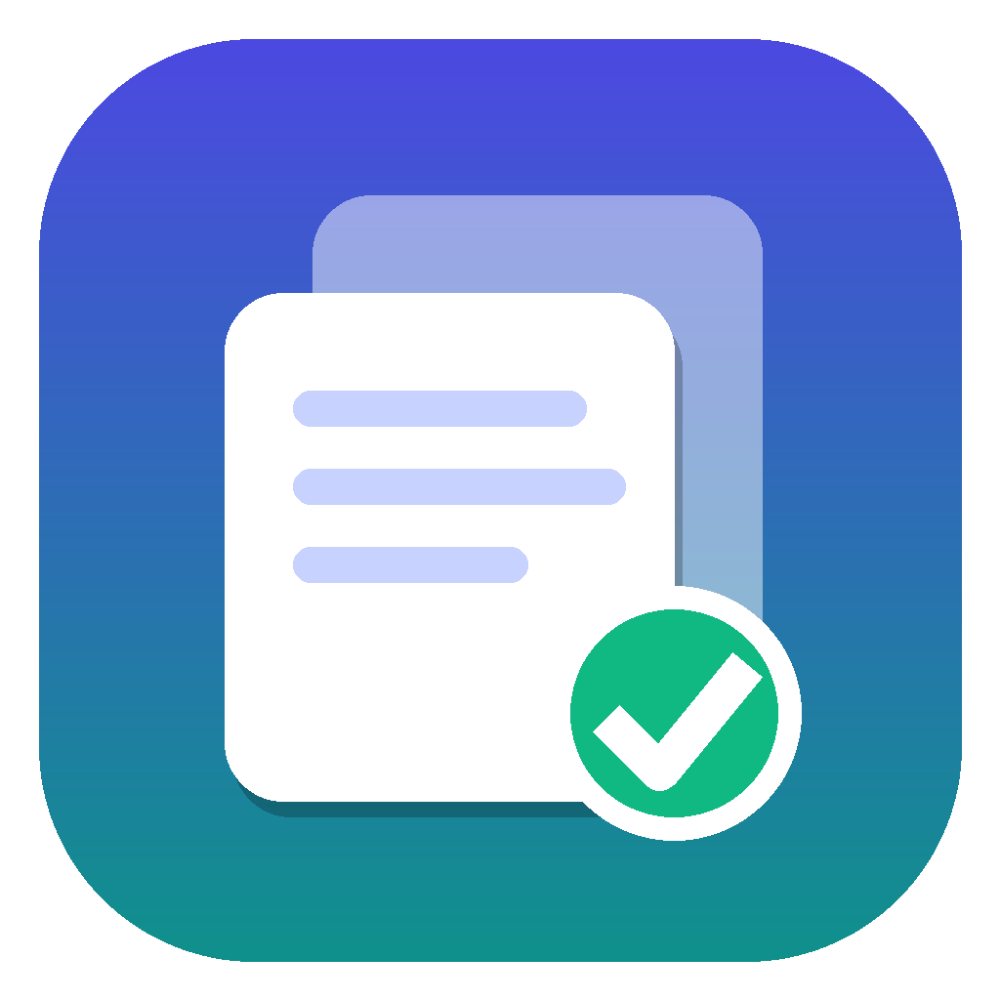

# DupeSort



A desktop app for Windows, macOS and Linux, created by **Ryan Ocbina Barnal**. It finds duplicate **music, photos, videos and documents**, moves the extra copies into a `_Duplicates` folder, tidies up what's left, and converts files between formats. Nothing is ever deleted, and every change can be undone from the **History** page.

The full user guide is in the app (**Help → DupeSort User Guide**) and at [`dupesort/gui/guide.html`](dupesort/gui/guide.html).

## What it does

| | Finds duplicates by | Organizing (optional) |
|---|---|---|
| **Music** | identical file · same artist + title + length · same *sound* (Chromaprint fingerprint, catches MP3 vs FLAC copies) | Looks up title, artist, album, album artist, genre, year, track number and cover art (MusicBrainz), plus lyrics (LRCLIB). Lyrics are embedded in the file. Files are renamed in place to `Artist - Title` (the pattern is editable). |
| **Photos** | identical file · visually similar (perceptual hash; catches resized and re-saved copies) | Moves photos into `YYYY/MM` folders by the date taken (EXIF). |
| **Videos** | identical file · same video re-encoded (frame fingerprints, needs FFmpeg) | `YYYY/MM` date folders. Renames movies to `Title (Year)` and episodes to `Show - S01E02 - Name` using TMDb. |
| **Documents** | identical file · same text in different files or formats (e.g. a `.docx` and its `.pdf`) | Sorts into PDF / Word / Spreadsheets / Presentations / Text / eBooks folders. |

**How it works:**
- In each duplicate group the app ticks the best copy to keep: highest quality (bitrate, lossless, resolution), or the oldest, newest or shortest path. You can change any tick.
- **Move duplicates** relocates the unticked copies to `<scanned folder>/_Duplicates/<original sub-folder>/`.
- **Music lookups:** matches at or above the confidence threshold (default 90%) are ticked automatically. Orange rows need review: pick another online match from the dropdown, or type the details yourself.
- **History:** every move, rename and tag change is logged and can be undone.
- **Versions stay apart:** live, acoustic, unplugged, remix, demo and other versions of a song are not treated as duplicates of the studio take. The version is read from the title, file name, album, genre and folder name (on by default; *Keep versions apart* on the Music page).
- **Automatic updates:** DupeSort checks GitHub releases at start-up and every 6 hours. Windows installs the update and restarts; macOS and Linux download it and show it. *Help → Check for updates…* checks on demand.

## Converters

Each section has a convert tab. Originals are never changed; new files are saved next to them or in a folder you choose.

| | Converts |
|---|---|
| **Music → Convert** | MP3, AAC/M4A, Opus, Ogg Vorbis, FLAC, ALAC or WAV, at 64–320 kbps. Never raises the bitrate above the source (optional). Tags, lyrics and cover art are copied over. |
| **Photos → Convert & resize** | JPEG, PNG or WebP (HEIC input supported). Quality slider, fit-within-pixels, percent scaling, PNG colour reduction, and removing camera/GPS data. Upscale 2×/4× with simple Lanczos + sharpening, or with **AI** (Real-ESRGAN, downloaded once on first use, ~50 MB). |
| **Videos → Convert & resize** | MP4, MOV, MKV, WebM or AVI. H.264, H.265, VP9 or AV1. Resolution 360p–4K. Aspect ratios 16:9, 9:16, 1:1, 4:5, 4:3 and 21:9, with fit (bars), fill (crop) or stretch. Quality presets from "High" to "Small file". |
| **Documents → PDF tools** | Images → PDF, PDF → images, Word/Excel/PowerPoint → PDF (needs LibreOffice, or Microsoft Office on Windows), PDF → text, merge PDFs, compress PDFs. |

## Look and feel

- **Minimal, monochrome design** in the same style as Pulsewave and Tala PDF: hairline borders, flat buttons, and thin outline icons on every command button. **Light, dark or match-system** mode. The default accent, **Mono**, keeps everything black-and-white; eight colour accents are also available (View → Appearance, or Settings).
- **Animated intro** at start-up, which you can skip with a click or turn off in View or Settings. `python packaging/render_intro.py` exports it as a 1080p video (`--vertical` gives 1080×1920 for Reels/TikTok).
- **Logo:** "Twin Rings": two thin white rings on a black tile (`packaging/logos/logo7.svg`). The earlier designs are still in `packaging/logos.py`. After changing it, run `python packaging/logos.py` and `python packaging/make_icons.py`.
- **Help & Support** page: user guide, email support (version and OS are pre-filled), credits, and an optional **Donate** button. Set `DONATE_URL` in `dupesort/__init__.py` to show it.

## Web app

**https://dupesort.ryanbarnal.com** is a browser version for a quick check, plus a download page for the installers (it always lists the latest GitHub release). Files are read on the device and never uploaded.

- It finds identical files of any kind, songs with the same artist and title (versions kept apart, the same rules as the desktop app) and similar photos (the same perceptual hash and tolerance as the desktop app).
- In Chrome and Edge it moves duplicates into `_Duplicates`, with undo. Safari and Firefox can only read folders, so there it lists what it finds and saves a CSV report.
- It lives in `web/` as plain HTML, CSS and JavaScript, with no build step. `.github/workflows/pages.yml` runs the tests (`node --test tests/web/*.test.mjs`) and publishes `web/` to GitHub Pages on every push to `main` that changes it.
- To try it locally, run `python3 -m http.server -d web 8000` and open http://localhost:8000.

## Run from source

```bash
python3 -m venv .venv
.venv/bin/pip install -r requirements.txt
.venv/bin/python -m dupesort
```

On Windows the commands are `.venv\Scripts\pip` and `.venv\Scripts\python`.

## Optional helpers (recommended)

| Tool | Enables | Install |
|---|---|---|
| **Chromaprint `fpcalc`** | "same sound" music matching, plus AcoustID lookups for songs with no tags | macOS: `brew install chromaprint` · Linux: `apt install libchromaprint-tools` · Windows: [acoustid.org/chromaprint](https://acoustid.org/chromaprint) |
| **FFmpeg** | re-encoded video matching and video recording dates | macOS: `brew install ffmpeg` · Linux: `apt install ffmpeg` · Windows: [ffmpeg.org](https://ffmpeg.org/download.html) |

The app finds these on your `PATH`. For a self-contained build, put the executables in a `bin/` folder before building and they are bundled. Run the app with `--check` to see which helpers it found.

## Free API keys (optional, in Settings)

- **TMDb**: movie and TV names. Get a key at themoviedb.org → Settings → API.
- **AcoustID**: identifies songs by their sound when the tags and filename are useless. Register an application at acoustid.org.

MusicBrainz, Cover Art Archive and LRCLIB need no key. MusicBrainz allows one request per second, so the first lookup of a large library takes a while. Each artist's albums are cached for the rest of the session.

## Installing

- **macOS:** open `DupeSort-<version>-macOS-arm64.dmg` and drag **DupeSort** onto **Applications**. If the build isn't signed with an Apple Developer ID, macOS warns the first time it opens: right-click the app → **Open** → **Open**. On recent macOS versions you may need **System Settings → Privacy & Security → Open Anyway** instead.
- **Windows:** run `DupeSort-<version>-Windows-Setup.exe`. It installs for your user account without admin rights (all users can be chosen instead), adds a Start-menu entry and, optionally, a desktop shortcut. Remove it from **Settings → Apps**. Unsigned installers trigger SmartScreen: click **More info → Run anyway**.

Your settings and undo history are kept when you uninstall or upgrade.

## Building the installers

Each installer must be built on its own OS.

**macOS (.dmg):**
```bash
packaging/build_macos.sh
```
Output: `dist/DupeSort-<version>-macOS-<arch>.dmg`. Helpers in `bin/` are bundled. To sign and notarize, set `DEVELOPER_ID` and `NOTARY_PROFILE`; see the comments in the script.

**Windows (Setup.exe):** install [Inno Setup 6](https://jrsoftware.org/isdl.php), then:
```powershell
powershell -ExecutionPolicy Bypass -File packaging\build_windows.ps1 -FetchHelpers
```
Output: `dist\DupeSort-<version>-Windows-Setup.exe`. `-FetchHelpers` downloads the Windows versions of fpcalc (Chromaprint) and FFmpeg (BtbN builds) so they are bundled.

**All platforms at once:** push a tag such as `v0.1.0` to GitHub. `.github/workflows/build.yml` tests the app, builds the DMG, the Setup.exe and a Linux `.tar.gz`, and attaches them to a GitHub release.

The app icon is drawn by `packaging/make_icons.py`, which writes `icon.png`, `icon.ico` and `icon.icns`.

## Tests

```bash
python -m pytest tests
```

## Where data is stored

Settings and the undo history live in the OS's standard app-data folder (via `platformdirs`). Open it from **History → Open history folder**.
